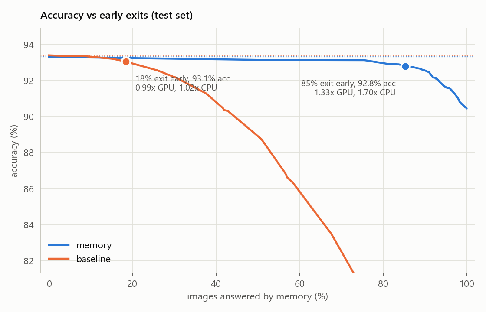
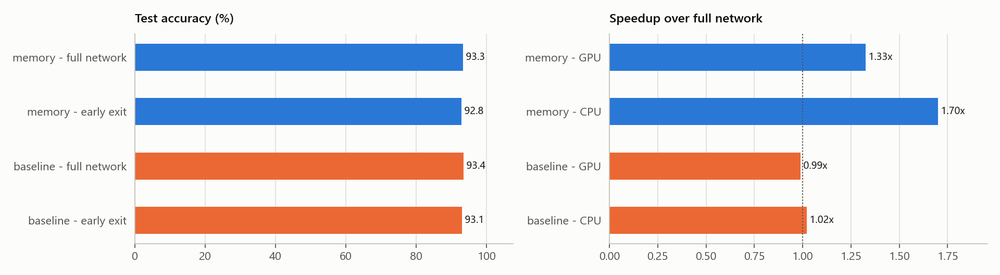
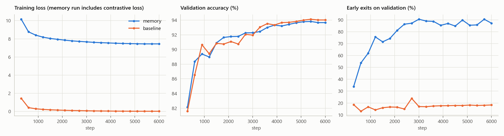

# Memory-Assisted Early-Exit Classifier

A ResNet that answers easy images from a memory instead of running the whole network.

The network is cut in two. After the early stages, a small key is computed and looked up in a
memory of training examples (k-nearest neighbours). If the neighbours agree strongly, the
memory's answer is returned and the remaining stages are **skipped**. Otherwise the image goes
through the rest of the network as usual.

```
image -> early stages -> key -> memory (k-NN) -- confident? --> answer   (fast path)
                                                    |
                                                    no
                                                    v
                                     late stages -> head -> answer       (full path)
```

The confidence threshold is picked on the validation set: the lowest threshold (most early
exits) whose accuracy stays within `max_drop` points (default 0.5) of the full network.

## Results

CIFAR-10 upscaled to 64px, ResNet-18 (ImageNet-pretrained, timm), memory after `layer2`,
6000 steps, single run with seed 0. `baseline` is the same network trained without the
memory loss. Speedup is measured against the same model running the full network.

| Test set (10k images)                        | memory                   | baseline                 |
|----------------------------------------------|--------------------------|--------------------------|
| Full network accuracy                        | 93.32%                   | 93.41%                   |
| Memory-only accuracy (k-NN after `layer2`)   | 90.46%                   | 67.63%                   |
| **Early-exit accuracy**                      | **92.79%**               | 93.06%                   |
| **Images that exit early**                   | **85.4%**                | 18.4%                    |
| Threshold (picked on validation)             | 0.81                     | 0.81                     |
| GPU throughput, batch 256 (img/s)            | 5178 -> 6866 (**1.33x**) | 5181 -> 5120 (0.99x)     |
| CPU throughput, batch 1 (img/s)              | 145 -> 246 (**1.70x**)   | 149 -> 152 (1.02x)       |

Takeaways:

- With the memory loss, 85% of test images skip `layer3`, `layer4` and the head. Accuracy
  drops by 0.5 points (93.3 -> 92.8). CPU throughput goes up 1.7x and GPU throughput 1.33x.
- Without the memory loss (baseline), features after `layer2` are poor for k-NN (68%), so
  only 18% of images can exit and there is no speedup.
- The memory loss costs almost nothing on the full network (93.32 vs 93.41).
- The CPU number was measured while another job was using the machine. An earlier run of the
  same configuration measured 2.02x (see the table below).

Full logs: [results/train.log](results/train.log). All numbers: [results/results.json](results/results.json).





### Choosing the exit point

Memory runs only, same settings otherwise:

| exit after | image size | full acc | early-exit acc | exits | GPU speedup | CPU speedup |
|---|---|---|---|---|---|---|
| layer3 | 32 | 87.89 | 87.83 | 100% | 1.08x | 1.52x |
| layer2 | 32 | 87.17 | 87.38 | 90% | 0.73x | 1.64x |
| layer3 | 64 | 93.94 | 93.65 | 100% | 1.17x | 1.27x |
| layer2 | 64 | 93.32 | 92.79 | 85% | 1.14x | 2.02x |

- A larger input gives about +6 points of accuracy. ImageNet-pretrained networks prefer bigger images.
- Exiting after `layer2` skips about half the network, so it gives the largest CPU speedup.
- Exiting after `layer3` keeps more accuracy but only skips `layer4`.
- GPU gains are small: at these image sizes a batched GPU is not compute-bound, and splitting a
  batch into hits and misses has its own cost. Early exit pays off most on CPU / edge devices
  and for single-image latency.

## How it works

- **Memory** ([mac/memory.py](mac/memory.py)): a ring buffer of normalised keys and labels.
  Reads are a similarity-weighted k-NN vote, and the vote share is the confidence. It is
  stored as buffers, so it is saved with the model.
- **Model** ([mac/model.py](mac/model.py)): `early -> proj` gives the memory key and
  `late -> head` gives the full prediction. `predict(x, threshold)` runs the late stages
  only for images the memory is unsure about.
- **Training** ([mac/train.py](mac/train.py)): cross-entropy on the full network plus a
  supervised contrastive loss that pulls each key towards same-class memory entries. The loop
  is step-based, with periodic validation, early stopping on validation accuracy, and the best
  weights restored at the end.
- **Evaluation** ([mac/evaluate.py](mac/evaluate.py)): both paths run once on every image,
  so every threshold can be scored offline. Speed is measured wall-clock: GPU throughput at
  batch 256 and CPU latency at batch 1.
- **Data** ([mac/data.py](mac/data.py)): CIFAR-10 kept on the GPU, with augmentation done on
  the GPU (no dataloader workers). 45k train / 5k val / 10k test.

## Usage

```bash
pip install -r requirements.txt
python main.py                          # memory + baseline runs, plots in results/
python main.py --runs memory            # one run
python main.py --exit-layer layer2      # exit earlier: faster, less accurate memory
python main.py --max-drop 1.0           # trade more accuracy for more early exits
python main.py --resume                 # continue from results/<run>_last.pt
```

Every field in [mac/config.py](mac/config.py) is a command-line flag. VS Code launch
configurations (train, resume, single run, smoke test) are in [.vscode/launch.json](.vscode/launch.json).

Each run writes to `results/`:

- `train.log`: progress at every evaluation, plus the final results table
- `results.json`: config, final metrics and training history
- `training.png`, `tradeoff.png`, `summary.png`: plots
- `<run>.pt`: best weights, memory included
- `<run>_last.pt`: checkpoint used by `--resume`

A checkpoint is saved at every evaluation, so an interrupted run can be resumed with
`--resume`. Training uses fp16 mixed precision on CUDA.

## Project layout

```
main.py           run experiments, write plots and results.json
mac/config.py     all settings
mac/data.py       CIFAR-10 on the GPU
mac/memory.py     k-NN memory
mac/model.py      early-exit ResNet
mac/train.py      training loop
mac/evaluate.py   metrics, threshold calibration, speed benchmark
mac/plots.py      figures
```

## Related work

- Kaiser et al., *Learning to Remember Rare Events*, ICLR 2017 (key-value memory with k-NN read-out)
- Teerapittayanon et al., *BranchyNet*, ICPR 2016 (early-exit networks)
- Khosla et al., *Supervised Contrastive Learning*, NeurIPS 2020
- Wu et al., *Unsupervised Feature Learning via Non-Parametric Instance Discrimination*, CVPR 2018 (memory bank)

## Contributors

- [Wajih Ullah Baig](https://github.com/wajihullahbaig)
- Claude (Anthropic)
